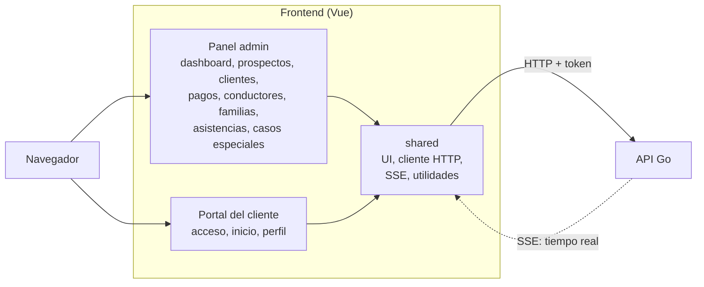

# Transporte Escolar · UI

Panel de administración y portal del cliente de un servicio de transporte escolar.

El panel y el portal usan sesiones separadas; ambos pasan por `shared` para hablar con la API y
reciben de ella los avisos en tiempo real (por ejemplo, cuando cambia un pago).

Más detalle (instalación, scripts, arquitectura y verificación): [docs/guia-del-proyecto.md](docs/guia-del-proyecto.md).
