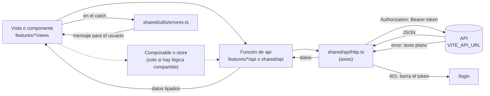
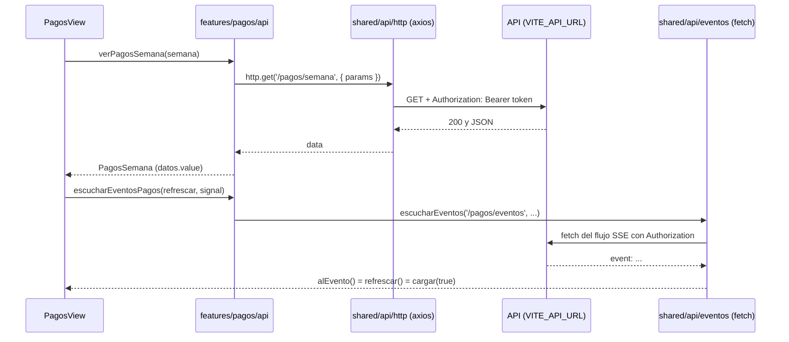

# Transporte Escolar · UI

Panel administrativo web para la gestión de un servicio de transporte escolar: clientes, prospectos, pagos semanales, asistencias y conductores.

Consume una API REST desarrollada en Go (repositorio independiente).

## Stack

- Vue 3 + TypeScript
- Tailwind CSS v4
- Pinia
- Vue Router
- Vite

Node `^22.18.0 || >=24.12.0` (ver `engines` en `package.json`).

Para arrancar en desarrollo: `npm run dev`.

## Scripts

| Comando           | Descripción                                                     |
| ----------------- | --------------------------------------------------------------- |
| `npm run dev`     | Servidor de desarrollo                                          |
| `npm run build`   | Build de producción (incluye `vue-tsc --build`)                 |
| `npm run preview` | Previsualiza el build                                           |
| `npm run lint`    | Linting con `--fix`: **modifica archivos** (ver "Verificación") |
| `npm run format`  | Formato de código                                               |
| `npm run capturas`| Capturas de regresión visual (ver "Verificación")               |

## Cómo lee el frontend del backend

Todo el tráfico con la API pasa por un único cliente axios (`src/shared/api/http.ts`), cuya URL base sale de la variable `VITE_API_URL`. El resto del código nunca llama a la API por su cuenta, salvo el flujo en tiempo real (más abajo).



La misma ruta en texto, por si el diagrama no se renderiza:

```
Vista (features/*/views)
  └─ [composable o store, solo si hay lógica compartida]
       └─ función de api (features/*/api o shared/api)
            └─ shared/api/http.ts (axios, baseURL = VITE_API_URL)
                 ├─ pone  Authorization: Bearer <token>  en cada petición
                 └─ API
                      ├─ 2xx + JSON  ──▶ la función devuelve los datos ──▶ la vista los guarda en un ref ──▶ la plantilla se actualiza
                      ├─ 401         ──▶ borra "token" y va a /login (recarga completa)
                      └─ otro error  ──▶ la vista lo captura ──▶ shared/utils/errores.ts ──▶ mensaje en pantalla
```

### El recorrido de una lectura

1. **La vista** (`features/*/views`) llama a una función de la carpeta `api/` de su feature o de `shared/api`. Hoy 11 de las 13 vistas lo hacen directamente. `LoginView` usa la store de auth y `FamiliasView` usa el `index.ts` de `clientes` y `useConsultaTelefono`.
2. **Composable o store**: solo intervienen cuando hay lógica compartida que llama a la API: la store de auth (`login` hace `POST /login`), `useConfiguracion` (la carga `App.vue` al montarse), `useOpcionesEscuela` (selectores de escuela) y `useConsultaTelefono`.
3. **La función de api** usa `http.get/post/put/patch`, devuelve `data` y normaliza lo necesario (por ejemplo `escuelas ?? []`).
4. **`http.ts` en cada petición** lee `token` de `localStorage` (no lo guarda en memoria) y, si existe, añade `Authorization: Bearer <token>`. La clave `token` la escribe la store de auth al iniciar sesión y la borra al cerrarla.
5. **La respuesta** vuelve como datos tipados, la vista los guarda en un `ref` (`datos`, `dia`, ...) y la plantilla se actualiza.
6. **Un 401** (sesión vencida o token inválido) lo captura el interceptor de respuesta de `http.ts`: borra `token` de `localStorage` y hace `window.location.href = '/login'` (recarga completa de la página, no pasa por el router). Después rechaza el error igual, así que el `catch` de la vista también se ejecuta. Los demás errores se rechazan tal cual.

El guard del router (`app/router/index.ts`) decide con `isAuthenticated` de la store de auth, que arranca leyendo ese mismo `token`.

### Cómo llegan los errores del servidor

El servidor explica sus errores con **texto plano** en el cuerpo de la respuesta (axios lo deja en `error.response.data` como `string`). `src/shared/utils/errores.ts` lo convierte en el mensaje que ve el usuario:

| Función | Qué hace |
| --- | --- |
| `mensajeDeError(e, respaldo)` | Texto del servidor (recortado) si lo hay; si no, el mensaje de respaldo de la pantalla |
| `mensajeDeEstado(e, estado, respaldo)` | Igual, pero solo para ese código HTTP (por ejemplo 400 o 409) |
| `textoDeEstado(e, estado)` | El texto del servidor o `null`, para pantallas que además necesitan reaccionar |
| `esEstado(e, estado)` / `esEstadoConTexto(e, estado, frase)` | Comprobaciones por código y por frase del servidor |

Cada pantalla pone su propio mensaje de respaldo, en español. Las **cargas de listas** (por ejemplo Pagos y Asistencias) muestran un mensaje fijo y no el texto del servidor; el texto del servidor se muestra en los **formularios y diálogos** de escritura (abonos, anular recibo, configurar cuota, archivar, ...). La única excepción conocida es el 409 al reincorporar un alumno con deuda: su cuerpo es un objeto con el campo `deuda`, y lo lee `ClienteDetalleModal` directamente.

### Tiempo real (SSE)

`src/shared/api/eventos.ts` (`escucharEventos`) mantiene abierto un flujo de eventos del servidor. Es la única excepción a "todo pasa por axios": usa `fetch`, porque `EventSource` no permite enviar `Authorization`. Lee el `token` de `localStorage` y la URL base de `http.defaults.baseURL`. Por cada bloque que empieza con `event:` llama a `alEvento()`; los comentarios de conexión y de latido se ignoran. El evento no trae datos: solo avisa de que algo cambió, y la vista vuelve a pedir la lista con su función de api.

| Ruta SSE | Función en su feature | Pantalla |
| --- | --- | --- |
| `/pagos/eventos` | `escucharEventosPagos` | Pagos |
| `/prospectos/eventos` | `escucharEventosProspectos` | Prospectos |
| `/recorridos/eventos` | `escucharEventosRecorridos` | Conductores (lista) |

Las tres vistas siguen el mismo patrón: un `AbortController`, un bucle que escucha y, si la conexión se cae, **refresca la lista, espera `ESPERA_RECONEXION_MS` (3000 ms) y reconecta**, y al desmontarse la vista se aborta. Como el flujo no pasa por axios, un 401 del propio flujo no redirige a `/login`; lanza `Error('Eventos: 401')` y la vista reintenta, y es el refresco que hace después (que sí pasa por axios) el que dispara el redirect.

### Ejemplo de punta a punta: la pantalla de Pagos



1. Al abrir `/pagos`, el router carga `PagosView` con `import()` y su `onMounted` ejecuta `cargar()` y `suscribirEventos()`.
2. `cargar()` llama a `verPagosSemana(semana)` de `features/pagos/api/pagos.ts`, que hace `http.get('/pagos/semana', { params: { semana } })`. Si no se pasa semana, la API devuelve la semana en curso.
3. `http.ts` añade el token, la API responde JSON, la función devuelve `{ ...data, escuelas: data.escuelas ?? [] }` y la vista hace `datos.value = nuevos`. La plantilla agrupa y filtra esos datos. Si falla, la vista muestra el mensaje fijo `No se pudieron cargar los pagos de la semana`.
4. `suscribirEventos()` abre `/pagos/eventos`. Cuando llega un `event:` se ejecuta `refrescar()`, que es `cargar(true)`: recarga sin atenuar la pantalla.
5. Al registrar un abono, `AbonoFamiliaForm` llama a `registrarAbono(...)` (`POST /clientes/{id}/abonos`). Si el servidor rechaza, `mensajeDeError(e, 'No se pudo guardar el pago')` muestra el texto del servidor o, si no lo hay, ese respaldo. Un 409 cuyo texto contiene «ya se registró» (doble toque) se trata como éxito, porque el primer envío ya quedó guardado.

## Estructura de `src/`

El código se organiza por funcionalidad (features) más una capa compartida. El alias `@` apunta a `src`.

```
src/
  main.ts  App.vue                 # arranque de la app (se quedan en la raíz de src)
  assets/main.css                  # tokens del tema y clases utilitarias (no se mueve)
  app/
    router/index.ts                # rutas y guard; carga cada vista con import() perezoso
    layouts/AppLayout.vue          # menú y marco de las pantallas autenticadas
  shared/                          # lo que usan varios features; no depende de ninguno
    api/                           # http (axios + token + 401), eventos (SSE), escuelas, configuracion, telefono
    composables/                   # useTema, useConfiguracion, useDestello, useFamilias, ...
    constants/  stores/  types/
    ui/                            # componentes visuales reutilizables (Spinner, ModalBase, CampoTexto, ...)
    utils/                         # funciones puras (moneda, fecha, semana, nombres, errores, ...)
  features/
    auth/  clientes/  prospectos/  pagos/  familias/  casos-especiales/
    asistencias/  conductores/  dashboard/  apariencia/  registro-publico/
      api/  types/  components/  composables/  utils/  stores/  views/   # solo las carpetas que hagan falta
      index.ts                     # solo en los features que otros importan (ver abajo)
```

Features con `index.ts` (tienen consumidores en otros features): `auth`, `clientes`, `pagos`, `casos-especiales`.

## Reglas de dependencia

1. `shared` no importa de ningún feature ni de `app` (tampoco de `auth`: `http.ts` maneja el 401 por su cuenta).
2. Un feature solo importa de otro por su `index.ts`, nunca por sus archivos internos, y solo por las aristas aprobadas:
   `clientes → auth`, `pagos → clientes, auth`, `familias → clientes`, `casos-especiales → clientes`, `dashboard → pagos, casos-especiales`.
3. Ningún feature importa de `app`.
4. Las vistas (`*View.vue`) nunca se importan de forma estática: solo `app/router` las carga con `import()`. Nunca van en un `index.ts`.
5. Un `index.ts` reexporta solo con nombre (sin `export *`) y solo api, utils, stores y tipos: **nunca un `.vue`**, para que importarlo no arrastre componentes al chunk de otra vista.
6. Un archivo no importa el `index.ts` de su propio feature.
7. Sin ciclos entre archivos ni entre features.

Estas reglas las comprueba `scripts/verificar-arquitectura.mjs`.

## Cuándo usar `shared` y cuándo un `index.ts`

- **Va en `shared`** lo que usan dos o más features sin pertenecer a ninguno (un componente visual, una utilidad pura, el cliente HTTP). Si solo lo usa un feature, se queda en ese feature, aunque sea genérico.
- **No crees un componente "genérico" para un solo uso**: extráelo cuando haya dos o más repeticiones reales.
- **Crea `features/<x>/index.ts` solo cuando otro feature necesite algo de `<x>`.** Exporta lo mínimo que consume ese otro feature. Si nadie de fuera lo importa, no hace falta.
- Si dos features se necesitan mutuamente, no se resuelve con un `index.ts`: lo común sube a `shared` o se replantea de qué feature es.

## Cómo agregar un feature

1. Crea `src/features/<nombre>/` con las carpetas que necesites (`views/`, `components/`, `api/`, `types/`, ...).
2. Escribe la vista en `views/<Nombre>View.vue`. La lógica va en composables y lo repetido en `shared/ui`.
3. Registra la ruta en `src/app/router/index.ts` con `component: () => import('@/features/<nombre>/views/<Nombre>View.vue')` (perezoso, con su `path` y `name`).
4. Añade la entrada al menú en `src/app/layouts/AppLayout.vue` si corresponde.
5. Si importa algo de otro feature, ese feature debe exponerlo en su `index.ts`, y la arista nueva se añade a `ARISTAS_APROBADAS` en `scripts/arquitectura/mapa.mjs`.
6. Corre la verificación (siguiente sección).

## Verificación

Desde la raíz del proyecto:

| Qué | Comando |
| --- | --- |
| Tipos | `npx vue-tsc --noEmit` |
| Build | `npm run build` |
| Arquitectura | `node scripts/verificar-arquitectura.mjs` (`--detalle` lista los pendientes; `--estricto` convierte los pendientes en fallos) |
| Linter, sin modificar archivos | `npx oxlint .` y `npx eslint . --no-cache` |

`npm run lint` aplica `--fix`: úsalo solo cuando quieras que corrija archivos.

### Capturas de regresión visual

`scripts/capturas.mjs` captura las pantallas en claro/oscuro y móvil/escritorio, y las compara con una base. Es de solo lectura: las peticiones que no son GET se abortan.

Requisitos: la API en marcha (la URL sale de `VITE_API_URL`), el puerto 5173 libre, y las credenciales de administrador en el `.env` del repositorio de la API (variables `ADMIN_CORREO` y `ADMIN_PASSWORD`, que se leen en memoria y no se escriben ni se imprimen).

```bash
node scripts/capturas.mjs capturar --salida base --desde-head   # graba la base compilando HEAD
node scripts/capturas.mjs comparar                              # captura el árbol actual y compara con la base
node scripts/capturas.mjs comparar --solo login,pagos           # solo algunas pantallas
node scripts/capturas.mjs diff --a base --b actual              # compara dos carpetas ya capturadas
```

Las capturas viven en `docs/capturas-*/` (ignoradas por git). Dependen de los datos de la base de datos local, de la fecha y de la configuración guardada (por ejemplo el color principal): **si cambian, regraba la base con `--desde-head` antes de comparar.**

### Pruebas de comportamiento

Cada prueba de `scripts/pruebas/` mide el comportamiento de una pantalla (diálogos, modales, campos, destello, escuelas, campos tocados, agrupación) contra HEAD y contra el árbol actual, y se comparan los dos JSON:

```bash
node scripts/capturas.mjs probar --prueba dialogos --desde-head   # mide HEAD  -> docs/comportamiento/dialogos-head.json
node scripts/capturas.mjs probar --prueba dialogos                # mide el árbol -> docs/comportamiento/dialogos-arbol.json
node scripts/capturas.mjs comparar-comportamiento --prueba dialogos
node scripts/pruebas/agrupacion-unit.mjs                          # comparación pura, sin navegador
```

Pruebas disponibles: `dialogos`, `campos`, `modales`, `destello`, `escuelas`, `tocados`, `agrupacion`.

## Documentación del refactor

En `docs/` están el inventario inicial (`inventario-frontend.md`), el detalle de cada fase (`fase1-utilidades.md`, `fase2a-componentes.md`, `fase2b-modales.md`, `fase3a-composables.md`, `fase3b-composables.md`) y la lista de deuda técnica pendiente (`deuda-tecnica.md`).
